<div align="center">

<h1>
  <picture>
    <source media="(prefers-color-scheme: dark)" srcset="assets/brand/svg/trayce-monitor-horizontal-fundo-escuro.svg">
    
  </picture>
</h1>

**A featherweight system monitor that lives in your Windows 11 tray.**
One ring in the tray. Hover for the live card. Click for the panel.

[](https://github.com/dvd-castro/trayce-monitor/actions/workflows/ci.yml)
[](LICENSE)


English | [Português (Brasil)](README.pt-BR.md)

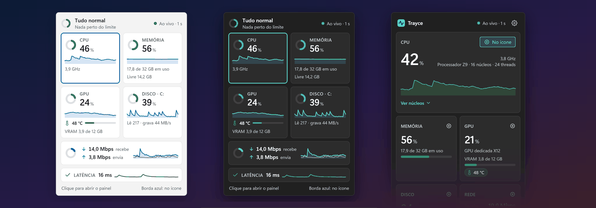

</div>

> [!NOTE]
> **Trayce Monitor is an early build.** You can [download it from Releases](#-download) (versions `0.x` are marked pre-release) or [build it from source](#%EF%B8%8F-build-from-source). Every screen on this page is a *design preview*, not a screenshot of the app, and some items under "Features" are not in the app yet.

## Contents

[Download](#-download) ·
[What it is](#-what-it-is) ·
[Previews](#%EF%B8%8F-previews) ·
[Features](#-features-planned-for-v1) ·
[Why it is light](#-why-it-is-light-measured-on-a-proof-of-concept) ·
[Architecture](#-architecture) ·
[Privacy](#-privacy) ·
[Roadmap](#%EF%B8%8F-roadmap) ·
[Build from source](#%EF%B8%8F-build-from-source) ·
[FAQ](#-faq) ·
[Contributing](#-contributing) ·
[License](#-license)

## 📥 Download

Get the latest version from the **[Releases page](https://github.com/dvd-castro/trayce-monitor/releases/latest)**. Requirements: **Windows 11, 64-bit (x64)**. No administrator rights and no separate .NET install are needed.

| File | What it is |
|---|---|
| `TrayceMonitor-<version>-win-x64-setup.exe` | **Installer, per user.** Installs to `%LOCALAPPDATA%\Programs\Trayce Monitor` without administrator rights, adds a Start menu shortcut and an uninstaller (Settings > Apps). "Start with Windows" is offered and **off** by default. |
| `TrayceMonitor-<version>-win-x64-portable.zip` | **Portable.** Extract anywhere and run `TrayceMonitor.exe`. Nothing is installed; delete the folder to remove it. |
| `SHA256SUMS.txt` | SHA-256 of the two files above, to check your download. |

### Windows SmartScreen warning

The binaries are **not code-signed yet**, and new files from a publisher Windows does not know get a reputation warning. When you run the installer or the exe you will probably see **"Windows protected your PC"**: click **More info**, then **Run anyway**. That is expected for now, and it is why you should check the file first, or [build it from source](#%EF%B8%8F-build-from-source) if you prefer.

To check a download, compare its SHA-256 with the line for that file in `SHA256SUMS.txt`:

```powershell
Get-FileHash .\TrayceMonitor-<version>-win-x64-setup.exe -Algorithm SHA256
```

The checksum only shows that the file was not corrupted or swapped after the release was built; it is published in the same place as the file, so it is not a substitute for a signature. Signed releases are an [open decision](#%EF%B8%8F-roadmap).

## 💡 What it is

Most system monitors want a window, a widget or a pile of tray icons. Trayce Monitor wants **one icon**:

- **A ring** in the notification area shows one metric at a glance. By default it is CPU usage; you can switch it to memory, GPU, GPU temperature, disk, network, or "worst metric".
- **Hover** over it and, after 400 ms, a small read-only **card** shows CPU, memory, GPU, GPU temperature, disk, network and (if you turn it on) network latency, all live. It never steals focus from what you are typing.
- **Click** it and a **panel** opens with 60-second history, per-core usage, and the details.

It is built to stay out of the way: no administrator rights, no driver, nothing running in the background except a small tray process, and a UI that follows your Windows theme, accent colour and high-contrast settings.

## 🖼️ Previews

> [!NOTE]
> **Design previews.** These images are rendered from the approved HTML design (v2.2) with fictional, animated data. They are *not* screenshots of the application, and none of this has been tested on Windows yet. The design is currently written in Brazilian Portuguese, so the UI text in the images is in Portuguese. The hover-card and panel previews are shown with the optional latency feature switched **on** to illustrate it; in the settings preview it is shown **off**, which is the default. A few texts, such as the first-run screen, were drawn before latency became off by default and will be updated.

### One ring, any taskbar

The ring is drawn as a smooth vector at the exact size Windows asks for, and it is readable on light, dark and accent-coloured taskbars and in high-contrast themes. Shape carries meaning as well as colour: ring = normal, ring with a dot = high, solid disc = critical.

<p align="center">
<picture>
  <source media="(prefers-color-scheme: dark)" srcset="docs/assets/tray-icons-dark.png">
  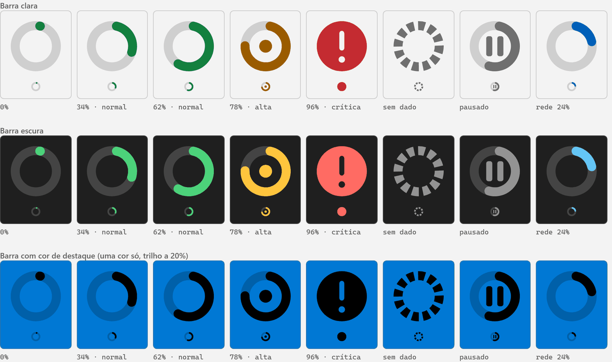
</picture>
</p>

### Hover card

<p align="center">
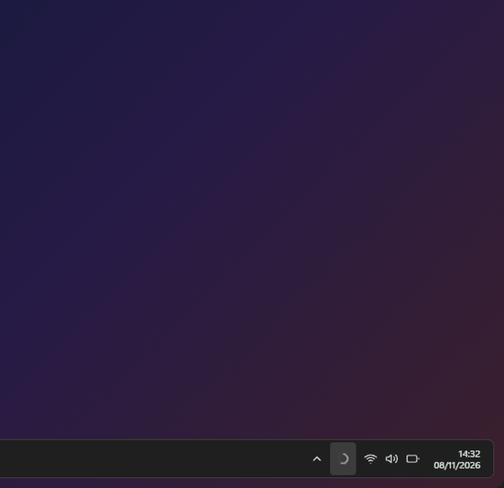
</p>

<table>
<tr>
<td align="center" width="50%">
<picture>
  <source media="(prefers-color-scheme: dark)" srcset="docs/assets/hover-card-dark.png">
  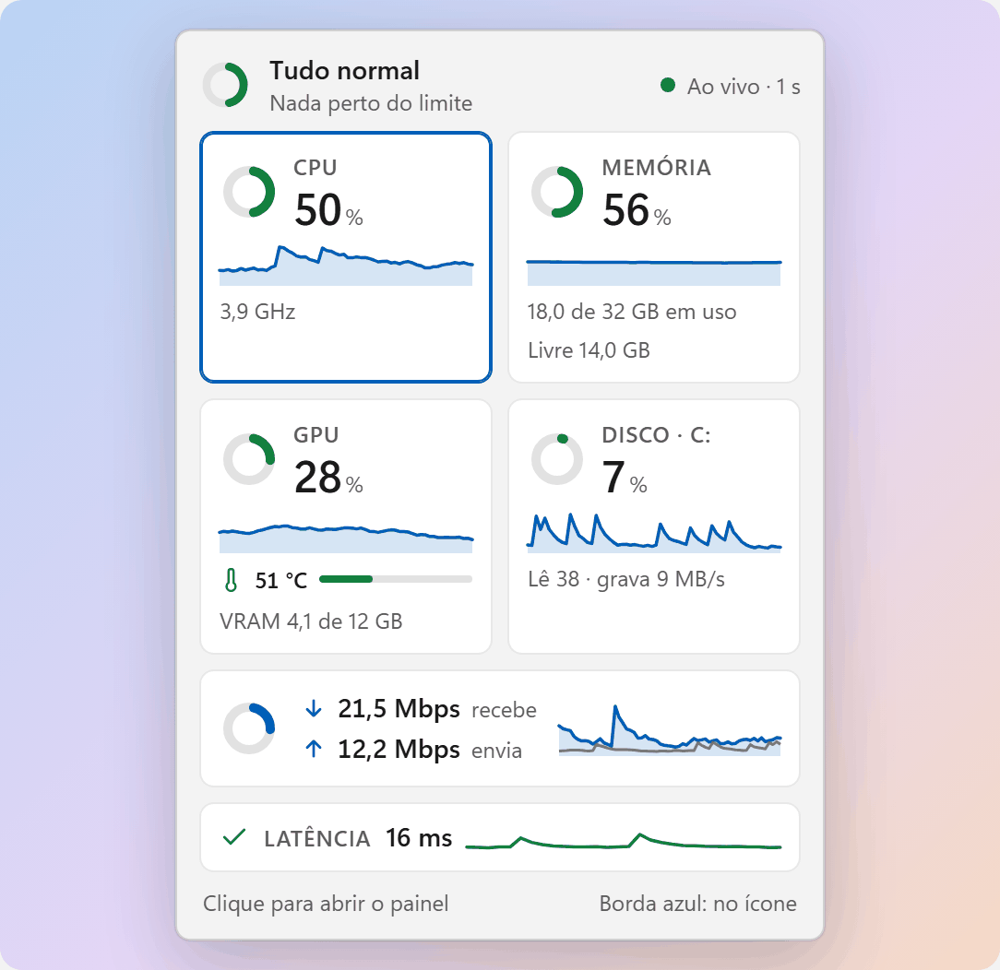
</picture>
<br><sub>Full card</sub>
</td>
<td align="center" width="50%">
<picture>
  <source media="(prefers-color-scheme: dark)" srcset="docs/assets/hover-card-compact-dark.png">
  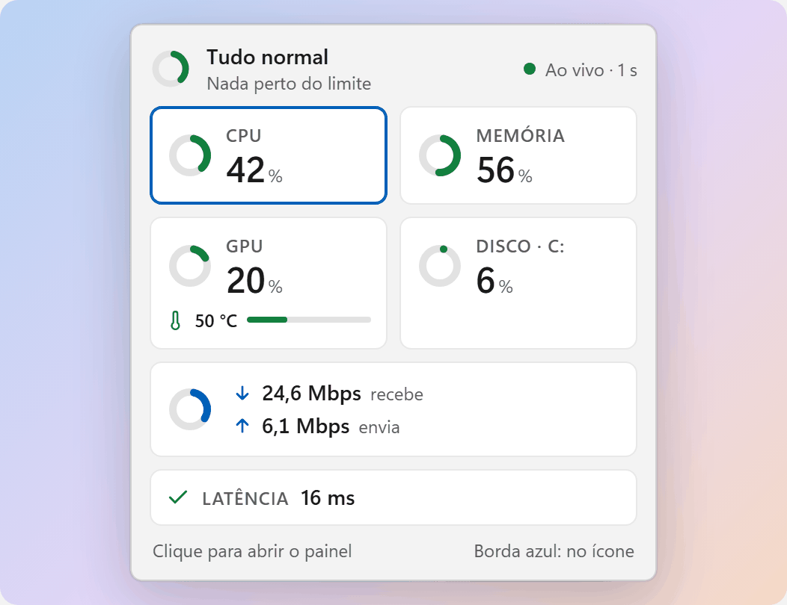
</picture>
<br><sub>Compact mode, used when the screen is too short or text is scaled</sub>
</td>
</tr>
</table>

### Panel and latency

<table>
<tr>
<td align="center" width="34%">
<picture>
  <source media="(prefers-color-scheme: dark)" srcset="docs/assets/panel-dark.png">
  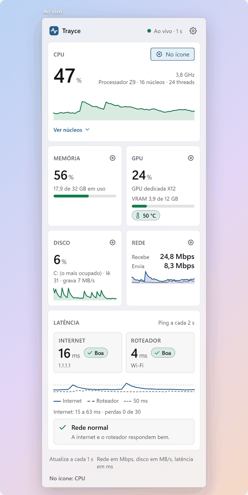
</picture>
<br><sub>Panel</sub>
</td>
<td align="center" width="33%">
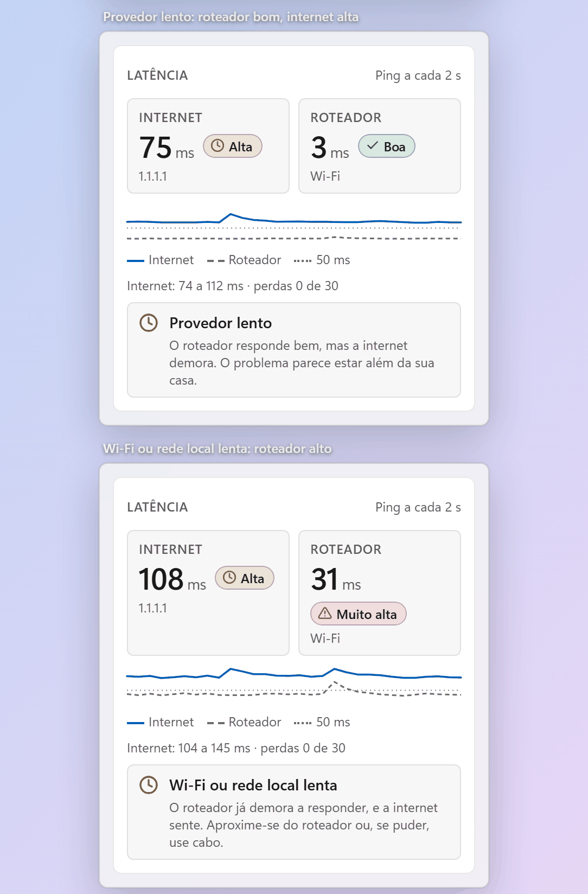
<br><sub>Latency block: internet x router, with a plain-language reading</sub>
</td>
<td align="center" width="33%">
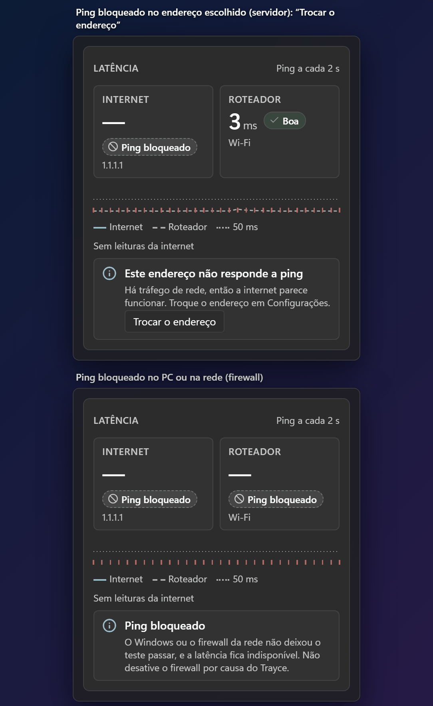
<br><sub>Honest states, such as blocked ping</sub>
</td>
</tr>
</table>

<table>
<tr>
<td align="center" width="50%">
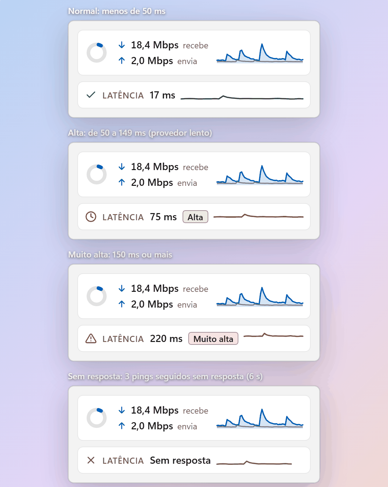
<br><sub>Latency strip on the card</sub>
</td>
<td align="center" width="50%">
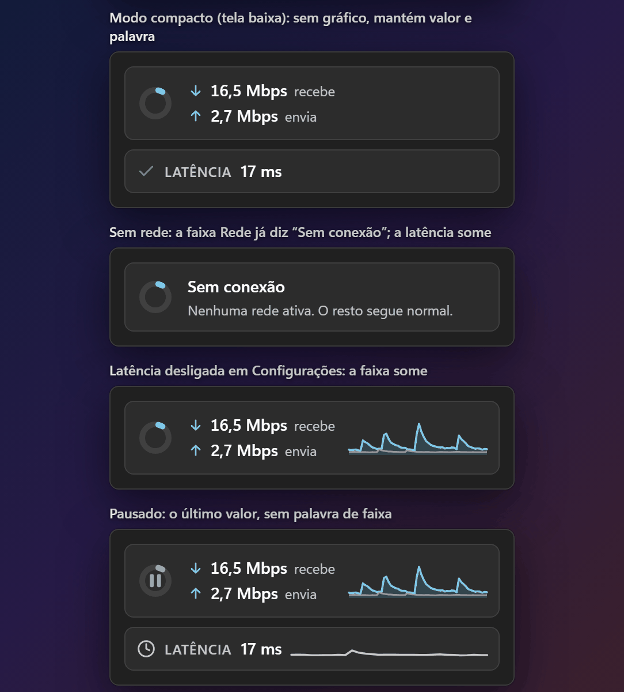
<br><sub>Compact, no network, switched off, paused</sub>
</td>
</tr>
</table>

### Settings and first run

<p align="center">
<picture>
  <source media="(prefers-color-scheme: dark)" srcset="docs/assets/settings-dark.png">
  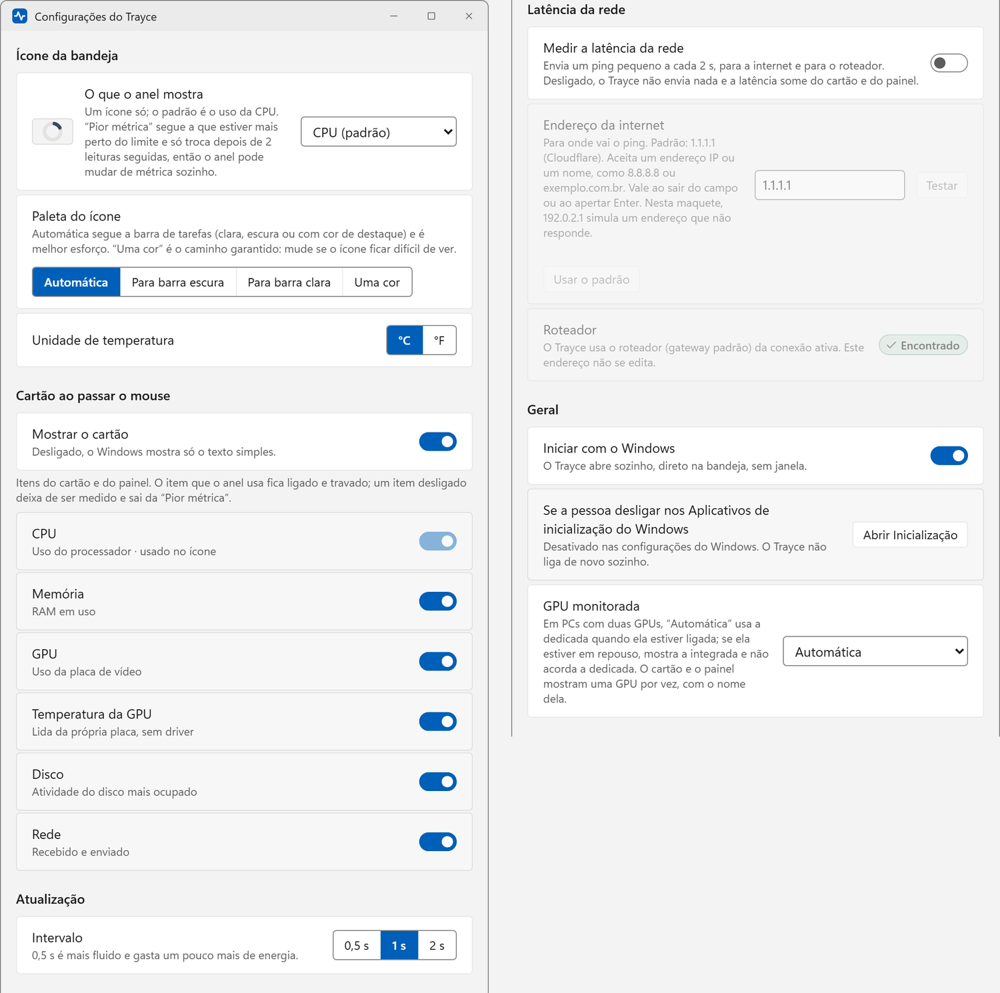
</picture>
</p>

<p align="center">
<picture>
  <source media="(prefers-color-scheme: dark)" srcset="docs/assets/onboarding-dark.png">
  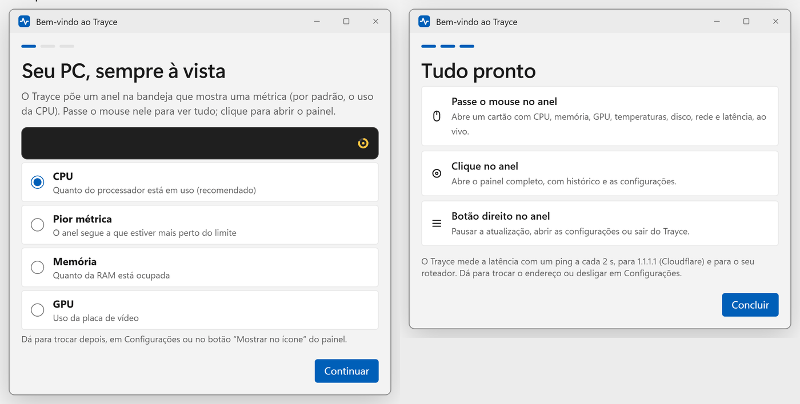
</picture>
</p>

## ✨ Features (planned for v1)

| | |
|---|---|
| **One tray icon** | A vector ring that shows CPU by default. Choose CPU, memory, GPU, GPU temperature, disk, network or "worst metric" (the one closest to its limit). Normal, high and critical are told apart by shape, not only by colour. |
| **Hover card** | Opens 400 ms after the pointer lands on the icon and closes shortly after it leaves. Read-only, never takes focus, sits just above the taskbar, and switches to a compact layout when the screen is short. |
| **Panel on click** | 60-second history, per-core view (grouped P and E cores on hybrid CPUs), and "Show on icon" buttons. Built with WinUI 3 and started on demand. |
| **GPU temperature without a driver** | Read from the graphics adapter through the Windows graphics kernel interface (D3DKMT). A temperature alert is available as a Windows notification. |
| **Latency (optional, off by default)** | Pings the internet (default `1.1.1.1`, editable) and your router every 2 seconds, with no administrator rights. The panel compares the two and gives a hedged plain-language reading ("Wi-Fi or local network slow", "Provider slow"). |
| **Follows Windows** | Light, dark and high-contrast themes, accent colour, transparency, animation and text-size settings. |
| **Accessible by design** | Nothing is communicated by colour alone. A text fallback names the icon for screen readers and for the default tooltip. Full keyboard path to the panel. |
| **No administrator, no driver** | Runs and installs per user. |
| **Settings** | Ring metric, icon palette (automatic, for dark bar, for light bar, single colour), °C or °F, which items to show, refresh interval (0.5, 1 or 2 s), start with Windows, which GPU to monitor, alerts. |
| **Per-user installer and portable build** | Both published with each release on [GitHub Releases](https://github.com/dvd-castro/trayce-monitor/releases/latest). The optional once-a-day update check is still planned. |

**Not in v1, on purpose:** CPU temperature. Reading it needs a kernel-mode sensor driver and administrator rights, so it is parked on the [roadmap](#%EF%B8%8F-roadmap).

## 🪶 Why it is light (measured on a proof of concept)

"Light" is a design goal, so it was tested before any application code was written. A throwaway proof of concept (Win32 tray icon, vector ring, Direct2D hover card, sensor sampling, ICMP) was built and measured. **These are PoC numbers from a single machine, not results from a Trayce Monitor release.**

| What | PoC result |
|---|---|
| Memory, idle (card and panel closed) | **14.0 to 15.3 MB** private commit (private working set 10.8 to 14.1 MB at p95) |
| Memory with the hover card open | **19.6 MB** median, 21.3 MB peak |
| Memory 60 s after the card closes | **16.2 MB** |
| Card opens | **455 to 472 ms** after the pointer lands (400 ms deliberate delay plus a 50 ms check step; 3 runs) |
| Card closes | **279 to 327 ms** after the pointer leaves (250 ms delay plus the same step; 3 runs) |
| Focus stolen from the app you are using | **0 of 27** hover-opens (foreground window unchanged every time) |
| Resource leaks | GDI handles **7 to 7** after 30 open/close cycles, and after 259 icon updates |
| Ping without administrator rights | **Works** (Windows ICMP API); 65 request pairs, 0 failures; 1.1.1.1 about 4 ms and router about 1 ms median on that machine; no measurable extra cost |
| GPU temperature without a driver | **Works** (D3DKMT) |

What the measurements also taught, which is why the design changed:

- Hardware-accelerated Direct2D used **66 to 71 MB** with the card open and took up to 9.7 s to create its resources. The card is therefore drawn with **software** rendering (about 6 MB extra, 7 to 88 ms to create).
- Reading network counters through PDH cost up to 6.8 s in a single call and froze the UI once. Sampling moved to its own thread and the network source moves to `GetIfTable2`.
- The Windows pointer-hover notification arrives about 5 ms after the pointer stops, so Trayce Monitor counts its own 400 ms.

**Not met yet, stated plainly:** idle CPU in the PoC was 1.2 to 1.3 % of one core against a v1 target of 0.5 % or less. That PoC run included a measurement probe and the machine was already busy, so it is not a clean figure, but it is above target and optimisation work is planned before v1.

**Conditions:** Windows 11 26H2 (build 26300.9711), Ryzen 5 4500, 15.9 GB RAM, 2560 x 1080 at 96 dpi, taskbar at the bottom, dark theme. The machine was already at 80 to 98 % CPU and 85 to 93 % RAM during the runs. PoC built with .NET 10, ReadyToRun and trimming (NativeAOT could not be built on that machine).

**Not tested:** other Windows builds, other DPI scales, the taskbar on other edges, auto-hide, multiple monitors, a real light taskbar, screen readers, and Acrylic glass on the card.

## 🧱 Architecture

Status: **proposal**, not final. Two processes, so the part that is always running stays tiny:

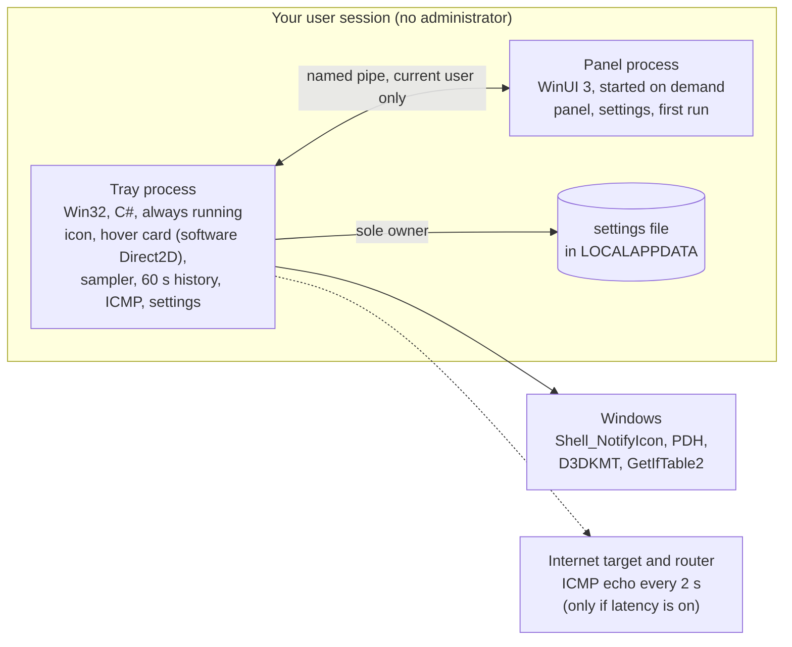

- **Tray process (Win32, C#):** the notification icon, the hover card, the sampler and the settings. The card is plain Win32 plus Direct2D and DirectWrite, with no XAML, so memory stays low. Its graphics resources exist only while the card is open (plus a few seconds).
- **Panel process (WinUI 3):** panel, settings window and first-run flow. It starts when you click, hides when you close it and exits after a few idle minutes. It never samples anything; it reads from the tray process over a per-user pipe.
- **Why not one process?** A resident WinUI process is estimated to cost 30 to 60 MB; the tray process alone has to fit in about 15 MB.
- **Stack:** C# on .NET 10, Win32, Direct2D, WinUI 3 (Windows App SDK). Release builds are NativeAOT, built in CI.

## 🔒 Privacy

Trayce Monitor is designed to collect **no personal data and no telemetry**. Everything it reads stays on your PC, history exists only in memory, and nothing is written to disk except your settings file.

There are exactly two ways Trayce Monitor can talk to the network, both visible in the UI and both switchable:

1. **Latency (opt-in, off by default).** When you turn it on, Trayce Monitor sends a small ICMP ping every 2 seconds to the address you choose (default `1.1.1.1`, operated by Cloudflare) and to your router. Whoever receives a ping can see your public IP address. The router address is detected automatically and cannot be edited, so Trayce Monitor is not a LAN scanner.
2. **Update check (planned).** Once a day, after first run, Trayce Monitor asks the GitHub Releases API whether a newer version exists. GitHub sees your IP address and the app version. It can be turned off and nothing is downloaded without a click.

Trayce Monitor never tells you to disable your firewall or antivirus, not even when ping is blocked.

## 🗺️ Roadmap

| Stage | What | Status |
|---|---|---|
| Design | UI design v2.2 (icon, card, panel, settings, first run, latency) | Done, approved |
| Proof of concept | Tray icon, hover card, sensors and ICMP measured on one machine | Done, throwaway |
| Architecture | Two-process design, sampling budget, packaging | Proposed |
| **v1** | Everything in [Features](#-features-planned-for-v1), per-user installer and portable build, GitHub Releases, CI | Early build (pre-releases on GitHub) |
| After v1 | CPU temperature through an **optional** driver, with an explicit administrator step in the installer | Idea, design kept on file |
| After v1 | winget package | Idea |
| After v1 | Signed releases | Open decision |
| Later | Taskbar on other edges (currently experimental in Windows Insider), more Windows builds and DPI scales verified | Idea |

## 🛠️ Build from source

You need Windows 11 and the [.NET 10 SDK](https://dotnet.microsoft.com/download/dotnet/10.0). Nothing else.

```powershell
git clone https://github.com/dvd-castro/trayce-monitor.git
cd trayce-monitor
dotnet build TrayceMonitor.slnx -warnaserror      # app + unit tests
dotnet test TrayceMonitor.slnx                    # core unit tests
dotnet publish src/TrayceMonitor -c Release -o out/publish   # self-contained, ReadyToRun + trimmed
.\out\publish\TrayceMonitor.exe
```

To produce the same files as a release (portable zip, SHA-256 and, if [Inno Setup 6](https://jrsoftware.org/isinfo.php) is installed, the installer) run `.\tools\build-release.ps1 -Version 0.1.0`. It uses NativeAOT when the MSVC linker is present and ReadyToRun otherwise; the files land in `out\release`. Releases are built by GitHub Actions when a `v*` tag is pushed.

- `TrayceMonitor.exe --selftest` opens the card and the panel without touching the mouse, writes the result to `%LOCALAPPDATA%\TrayceMonitor\trayce.log` and exits (exit code 0 = passed).
- `TrayceMonitor.exe --quit` closes the running instance.
- NativeAOT is available with `-p:TrayceAot=true`, but it needs the MSVC linker (Visual Studio Build Tools with the C++ workload).
- Settings live in `%LOCALAPPDATA%\TrayceMonitor\settings.json`.

## ❓ FAQ

<details>
<summary><b>Can I download it?</b></summary>

Yes. See [Download](#-download): an installer (per user) and a portable zip are on the [Releases page](https://github.com/dvd-castro/trayce-monitor/releases/latest). They are not code-signed yet, so Windows SmartScreen will warn you; that section explains what to click and how to check the SHA-256.
</details>

<details>
<summary><b>Why no CPU temperature in v1?</b></summary>

Windows does not expose it to normal programs. Reading it needs a kernel-mode sensor driver and administrator rights, and Trayce Monitor v1 promises neither. GPU temperature does not need a driver, so it is in. CPU temperature stays on the roadmap as an optional, clearly explained step.
</details>

<details>
<summary><b>Does it need administrator rights?</b></summary>

No. The installer is per user, the app runs unelevated, and the latency ping uses the Windows ICMP API, which works without elevation (confirmed in the PoC).
</details>

<details>
<summary><b>Why a ring instead of a number?</b></summary>

At 16 pixels a number is unreadable pixel text. A ring with a sweeping arc reads at a glance; the exact value is in the card.
</details>

<details>
<summary><b>Why is latency off by default?</b></summary>

It is the only feature that sends packets off your PC, and whoever receives them sees your IP address. It is one switch away, and the app says what it sends and to whom.
</details>

<details>
<summary><b>Which Windows versions are supported?</b></summary>

Windows 11 is the target. The design and the PoC were checked on a single Windows 11 build (26H2, 26300.9711) at 96 dpi; other builds and scale factors are untested.
</details>

<details>
<summary><b>Why are the previews in Portuguese?</b></summary>

The design was written in Brazilian Portuguese first. Localisation has not been planned yet.
</details>

## 🤝 Contributing

The repository lives at [github.com/dvd-castro/trayce-monitor](https://github.com/dvd-castro/trayce-monitor). The app is an early build and no pull-request flow is open yet; contribution guidelines will be added before the first release. The ground rules will be the project's priorities: **light first** (a feature that costs memory or CPU in the always-on process needs a measurement), **no administrator rights**, **accessible by default**, and **honest status** in the docs. Commits follow [Conventional Commits](https://www.conventionalcommits.org/).

## 📄 License

[MIT](LICENSE) © 2026 David Castro

*Trayce Monitor is not affiliated with other software named Trayce.*
