<div align="center">

<h1>
  <picture>
    <source media="(prefers-color-scheme: dark)" srcset="assets/brand/svg/trayce-monitor-horizontal-fundo-escuro.svg">
    
  </picture>
</h1>

**Um monitor de sistema levíssimo que mora na bandeja do Windows 11.**
Um anel na bandeja. Passe o mouse para ver o cartão ao vivo. Clique para abrir o painel.

[](https://github.com/dvd-castro/trayce-monitor/actions/workflows/ci.yml)
[](LICENSE)


[English](README.md) | Português (Brasil)

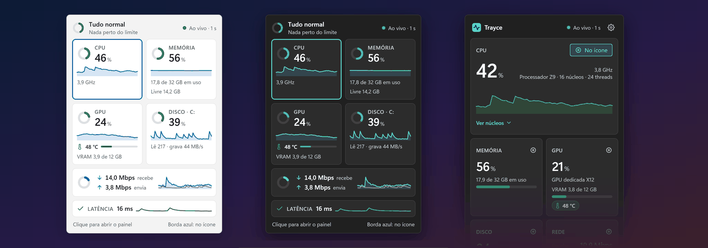

</div>

> [!NOTE]
> **O Trayce Monitor está em build inicial.** Você pode [baixar pela aba Releases](#-download) (versões `0.x` são marcadas como pré-release) ou [compilar a partir do código](#%EF%B8%8F-compilar-a-partir-do-código). Cada tela desta página é uma *prévia de design*, não uma captura do aplicativo, e alguns itens de "Recursos" ainda não estão no aplicativo.

## Conteúdo

[Download](#-download) ·
[O que é](#-o-que-é) ·
[Prévias](#%EF%B8%8F-prévias) ·
[Recursos](#-recursos-planejados-para-a-v1) ·
[Por que é leve](#-por-que-é-leve-medido-em-uma-prova-de-conceito) ·
[Arquitetura](#-arquitetura) ·
[Privacidade](#-privacidade) ·
[Roteiro](#%EF%B8%8F-roteiro) ·
[Compilar do código](#%EF%B8%8F-compilar-a-partir-do-código) ·
[Perguntas frequentes](#-perguntas-frequentes) ·
[Contribuir](#-contribuir) ·
[Licença](#-licença)

## 📥 Download

Baixe a versão mais recente na **[página de Releases](https://github.com/dvd-castro/trayce-monitor/releases/latest)**. Requisitos: **Windows 11, 64 bits (x64)**. Não precisa de direitos de administrador nem de instalar o .NET separadamente.

| Arquivo | O que é |
|---|---|
| `TrayceMonitor-<versão>-win-x64-setup.exe` | **Instalador, por usuário.** Instala em `%LOCALAPPDATA%\Programs\Trayce Monitor` sem direitos de administrador, cria um atalho no Menu Iniciar e um desinstalador (Configurações > Aplicativos). "Iniciar com o Windows" é oferecido e vem **desmarcado**. |
| `TrayceMonitor-<versão>-win-x64-portable.zip` | **Portátil.** Extraia em qualquer pasta e execute `TrayceMonitor.exe`. Nada é instalado; para remover, apague a pasta. |
| `SHA256SUMS.txt` | SHA-256 dos dois arquivos acima, para conferir o seu download. |

### Aviso do Windows SmartScreen

Os binários **ainda não são assinados** (assinatura de código), e arquivos novos de um editor que o Windows não conhece recebem um aviso de reputação. Ao executar o instalador ou o exe, você provavelmente verá **"O Windows protegeu o computador"**: clique em **Mais informações** e depois em **Executar assim mesmo**. Isso é esperado por enquanto, e por isso vale conferir o arquivo antes, ou [compilar a partir do código](#%EF%B8%8F-compilar-a-partir-do-código) se preferir.

Para conferir um download, compare o SHA-256 dele com a linha daquele arquivo em `SHA256SUMS.txt`:

```powershell
Get-FileHash .\TrayceMonitor-<versão>-win-x64-setup.exe -Algorithm SHA256
```

O checksum só mostra que o arquivo não foi corrompido nem trocado depois que a release foi gerada; ele é publicado no mesmo lugar do arquivo, então não substitui uma assinatura. Releases assinadas são uma [decisão em aberto](#%EF%B8%8F-roteiro).

## 💡 O que é

A maioria dos monitores de sistema quer uma janela, um widget ou um monte de ícones na bandeja. O Trayce Monitor quer **um ícone só**:

- **Um anel** na área de notificação mostra uma métrica num relance. Por padrão é o uso da CPU; dá para trocar por memória, GPU, temperatura da GPU, disco, rede ou "pior métrica".
- **Passe o mouse** nele e, depois de 400 ms, um **cartão** pequeno, só de leitura, mostra CPU, memória, GPU, temperatura da GPU, disco, rede e (se você ligar) a latência da rede, tudo ao vivo. Ele nunca rouba o foco do que você está digitando.
- **Clique** e um **painel** abre com histórico de 60 segundos, uso por núcleo e os detalhes.

Foi pensado para não atrapalhar: sem direitos de administrador, sem driver, nada rodando em segundo plano além de um pequeno processo de bandeja, e uma interface que segue o tema, a cor de destaque e o alto contraste do Windows.

## 🖼️ Prévias

> [!NOTE]
> **Prévias de design.** Estas imagens são renderizadas do design HTML aprovado (v2.2) com dados fictícios e animados. **Não** são capturas do aplicativo, e nada disso foi testado no Windows ainda. O design está escrito em português do Brasil, então o texto da interface nas imagens está em português. As prévias do cartão e do painel aparecem com o recurso opcional de latência **ligado**, para ilustrá-lo; na prévia das configurações ele aparece **desligado**, que é o padrão. Alguns textos, como a tela de primeiro uso, foram desenhados antes de a latência passar a vir desligada por padrão e serão atualizados.

### Um anel, qualquer barra de tarefas

O anel é desenhado como vetor liso, no tamanho exato que o Windows pede, e fica legível em barras claras, escuras e com cor de destaque, e em temas de alto contraste. A forma carrega significado, além da cor: anel = normal, anel com ponto = alta, disco cheio = crítica.

<p align="center">
<picture>
  <source media="(prefers-color-scheme: dark)" srcset="docs/assets/tray-icons-dark.png">
  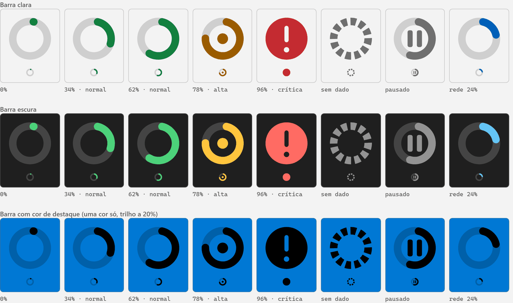
</picture>
</p>

### Cartão ao passar o mouse

<p align="center">
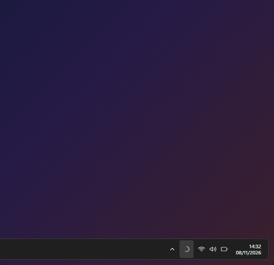
</p>

<table>
<tr>
<td align="center" width="50%">
<picture>
  <source media="(prefers-color-scheme: dark)" srcset="docs/assets/hover-card-dark.png">
  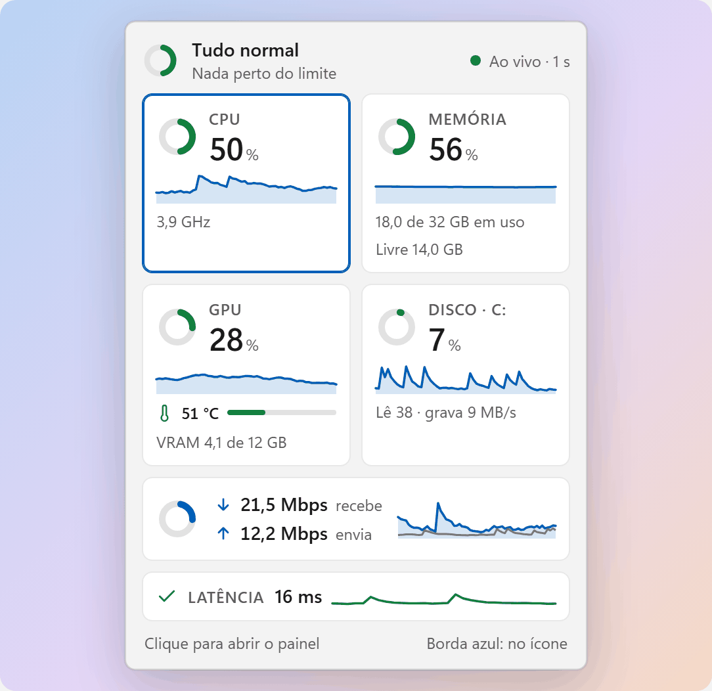
</picture>
<br><sub>Cartão completo</sub>
</td>
<td align="center" width="50%">
<picture>
  <source media="(prefers-color-scheme: dark)" srcset="docs/assets/hover-card-compact-dark.png">
  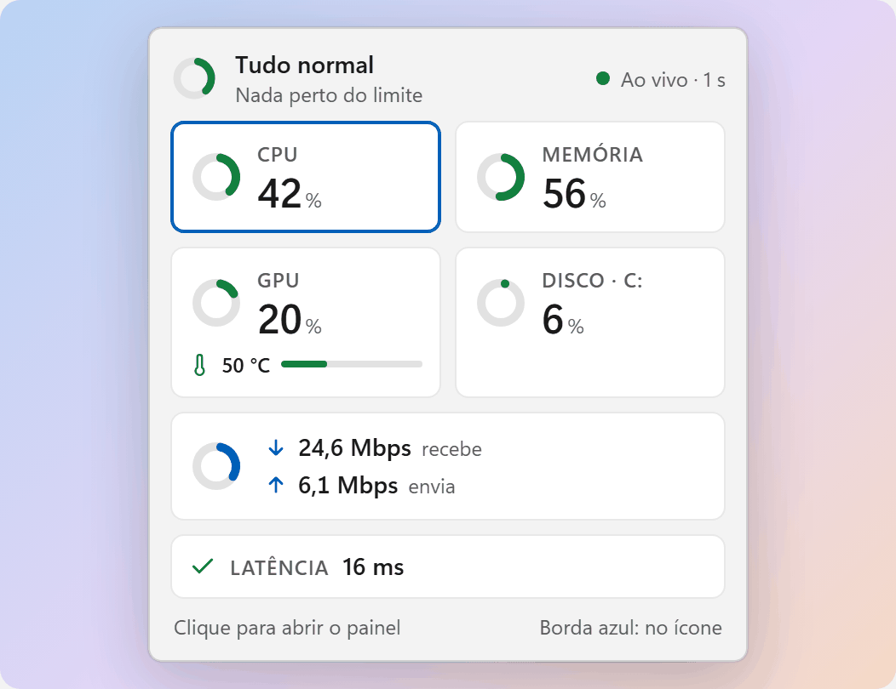
</picture>
<br><sub>Modo compacto, usado quando a tela é baixa ou o texto está ampliado</sub>
</td>
</tr>
</table>

### Painel e latência

<table>
<tr>
<td align="center" width="34%">
<picture>
  <source media="(prefers-color-scheme: dark)" srcset="docs/assets/panel-dark.png">
  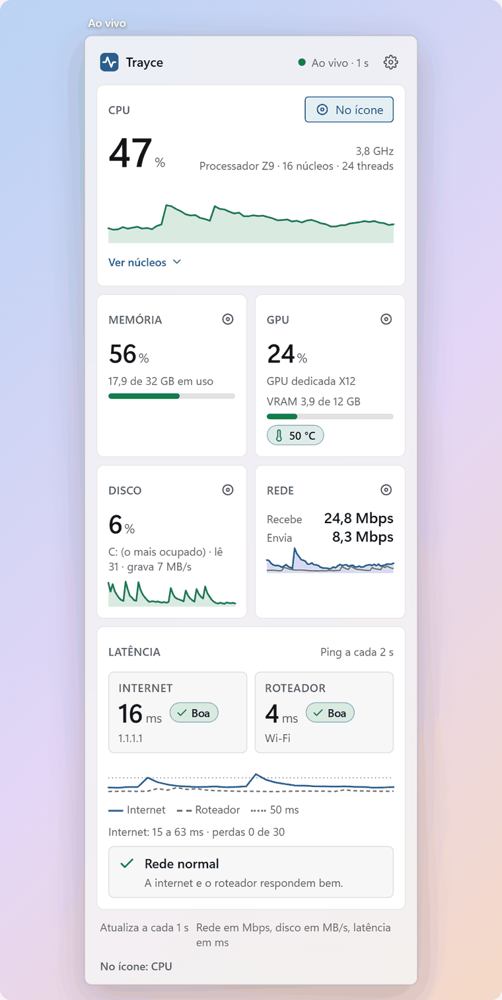
</picture>
<br><sub>Painel</sub>
</td>
<td align="center" width="33%">
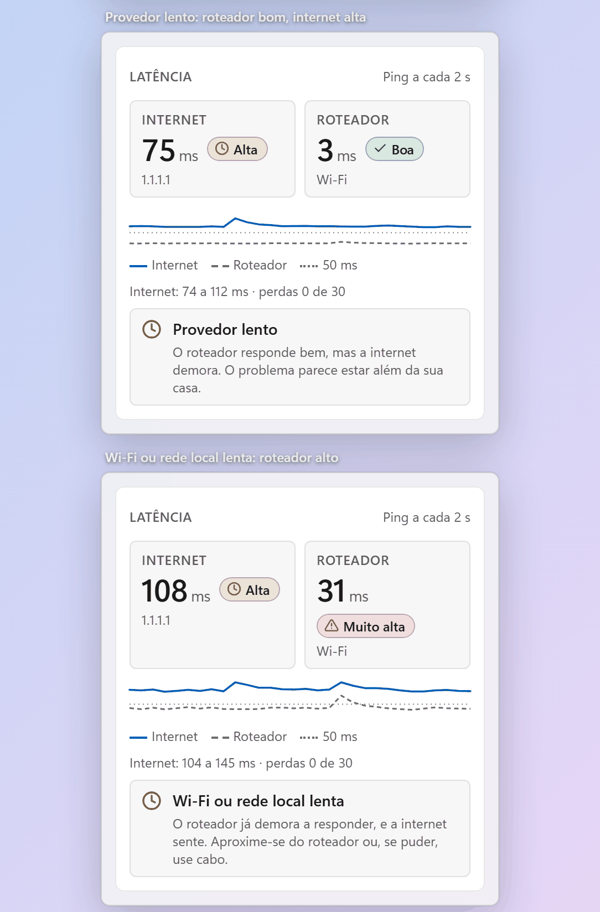
<br><sub>Bloco de latência: internet x roteador, com uma leitura em linguagem simples</sub>
</td>
<td align="center" width="33%">
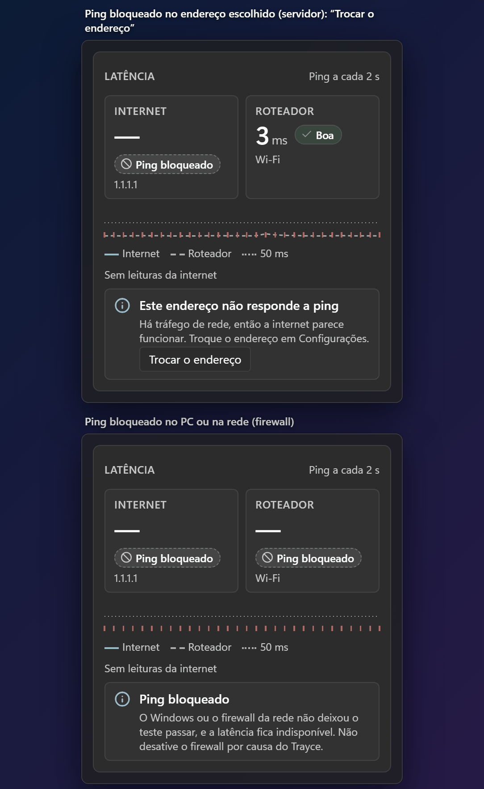
<br><sub>Estados honestos, como ping bloqueado</sub>
</td>
</tr>
</table>

<table>
<tr>
<td align="center" width="50%">
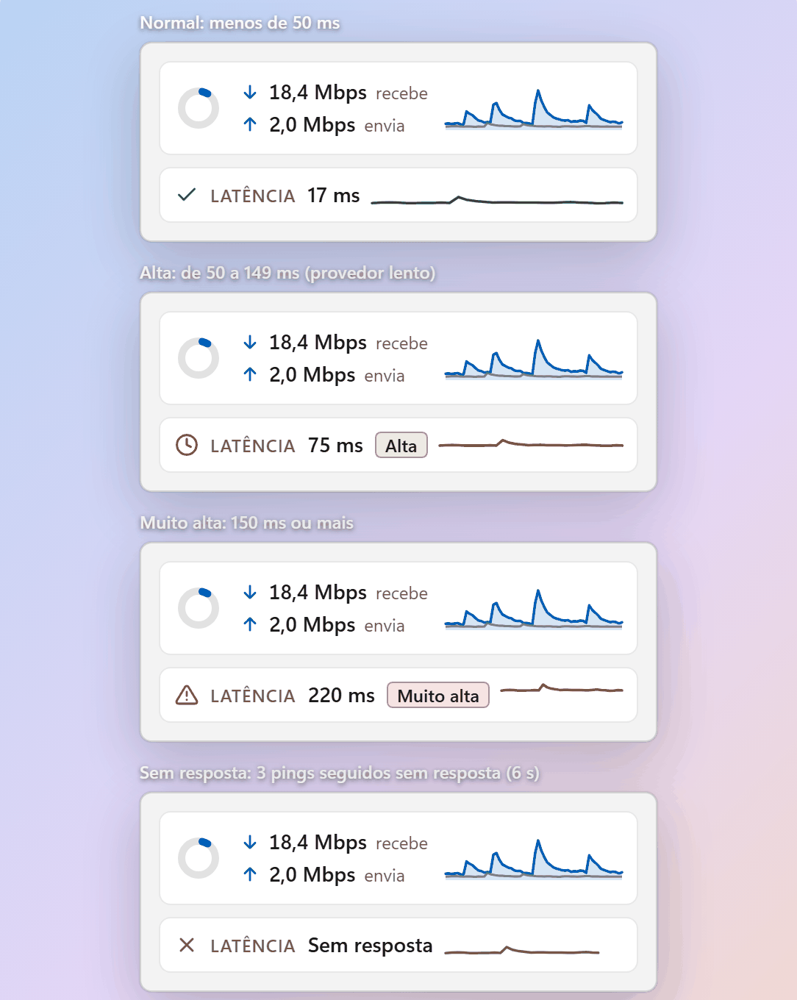
<br><sub>Faixa de latência no cartão</sub>
</td>
<td align="center" width="50%">
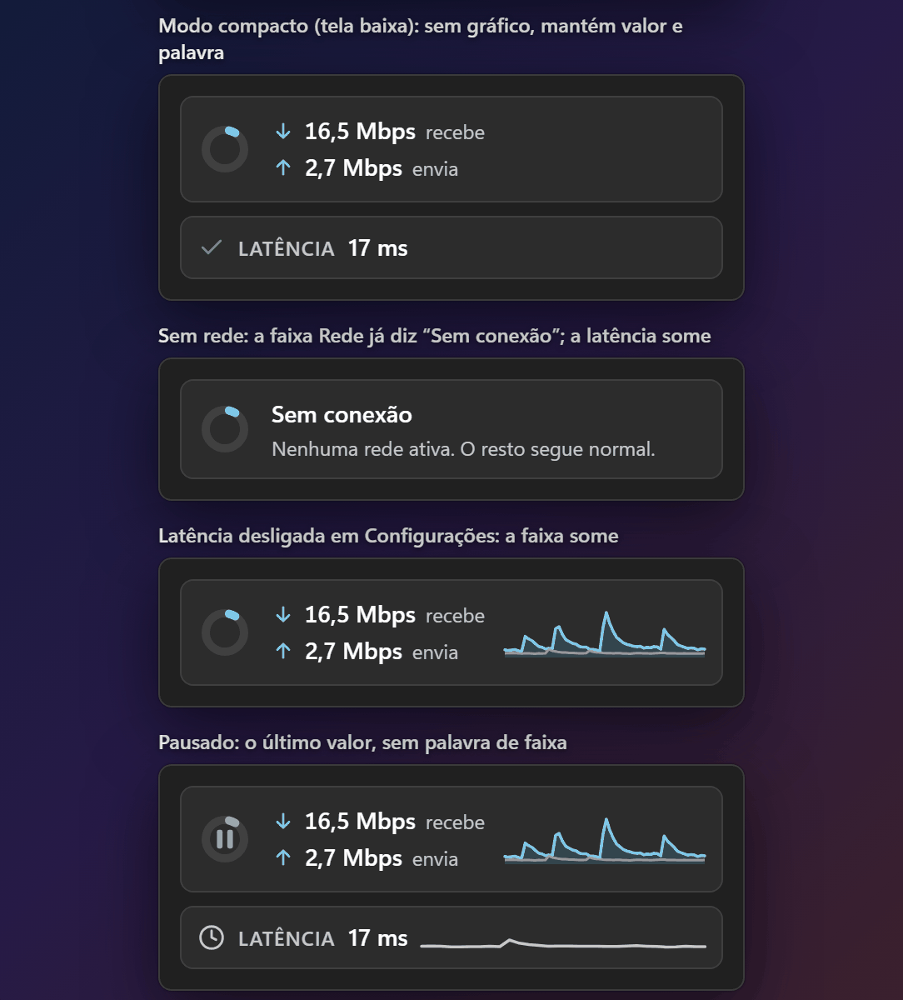
<br><sub>Compacto, sem rede, desligada, pausada</sub>
</td>
</tr>
</table>

### Configurações e primeiro uso

<p align="center">
<picture>
  <source media="(prefers-color-scheme: dark)" srcset="docs/assets/settings-dark.png">
  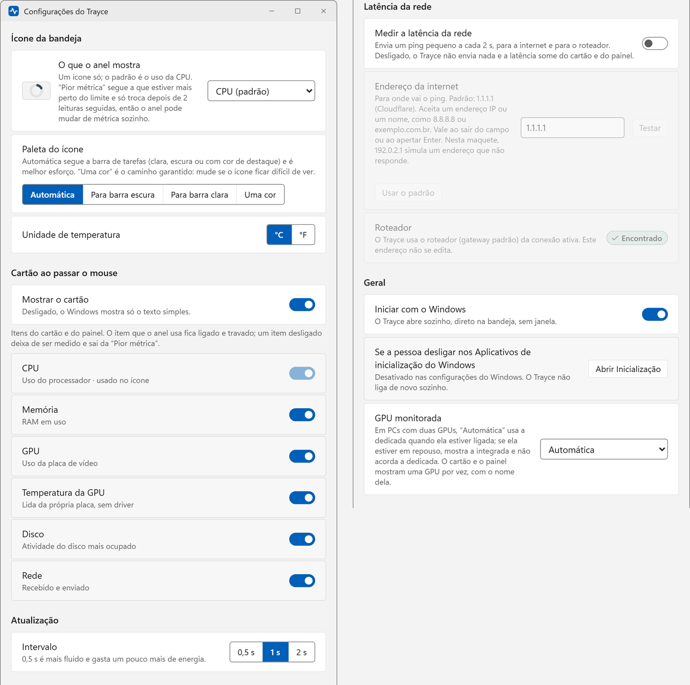
</picture>
</p>

<p align="center">
<picture>
  <source media="(prefers-color-scheme: dark)" srcset="docs/assets/onboarding-dark.png">
  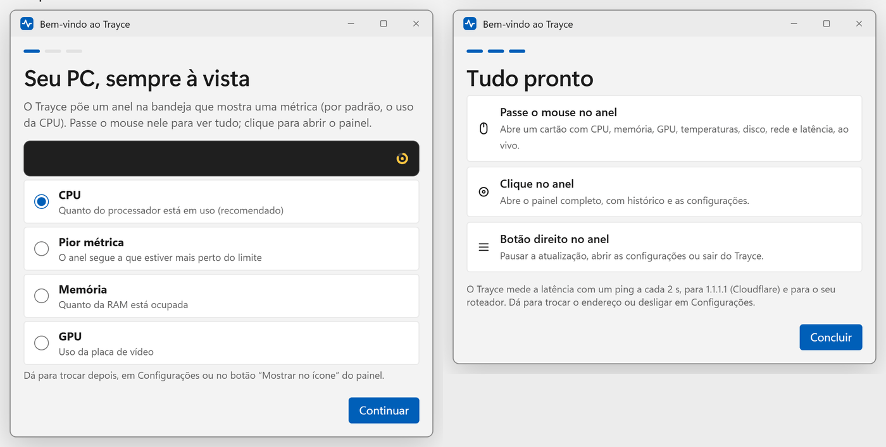
</picture>
</p>

## ✨ Recursos (planejados para a v1)

| | |
|---|---|
| **Um ícone só na bandeja** | Um anel vetorial que mostra a CPU por padrão. Escolha CPU, memória, GPU, temperatura da GPU, disco, rede ou "pior métrica" (a mais perto do limite). Normal, alta e crítica se distinguem pela forma, não só pela cor. |
| **Cartão ao passar o mouse** | Abre 400 ms depois de o ponteiro pousar no ícone e fecha pouco depois de ele sair. Só leitura, nunca pega o foco, fica logo acima da barra de tarefas e muda para um layout compacto quando a tela é baixa. |
| **Painel no clique** | Histórico de 60 segundos, visão por núcleo (núcleos P e E separados em CPUs híbridas) e botões "Mostrar no ícone". Feito em WinUI 3 e aberto sob demanda. |
| **Temperatura da GPU sem driver** | Lida da própria placa de vídeo pela interface gráfica do kernel do Windows (D3DKMT). Há um alerta de temperatura como notificação do Windows. |
| **Latência (opcional, desligada por padrão)** | Faz ping na internet (padrão `1.1.1.1`, editável) e no seu roteador a cada 2 segundos, sem direitos de administrador. O painel compara os dois e dá uma leitura prudente em linguagem simples ("Wi-Fi ou rede local lenta", "Provedor lento"). |
| **Segue o Windows** | Temas claro, escuro e de alto contraste, cor de destaque, transparência, animação e tamanho do texto. |
| **Acessível por desenho** | Nada é comunicado só por cor. Um texto de reserva dá nome ao ícone para leitores de tela e para o tooltip padrão. Caminho completo por teclado até o painel. |
| **Sem administrador, sem driver** | Instala e roda por usuário. |
| **Configurações** | Métrica do anel, paleta do ícone (automática, para barra escura, para barra clara, uma cor), °C ou °F, quais itens mostrar, intervalo de atualização (0,5, 1 ou 2 s), iniciar com o Windows, qual GPU monitorar, alertas. |
| **Instalador por usuário e versão portátil** | Os dois publicados a cada release no [GitHub Releases](https://github.com/dvd-castro/trayce-monitor/releases/latest). A checagem de atualização opcional, uma vez por dia, ainda é planejada. |

**Fora da v1, de propósito:** temperatura da CPU. Lê-la exige um driver de sensores em modo kernel e direitos de administrador, então ela está no [roteiro](#%EF%B8%8F-roteiro).

## 🪶 Por que é leve (medido em uma prova de conceito)

"Leve" é uma meta de design, então foi testada antes de qualquer código do aplicativo. Uma prova de conceito descartável (ícone de bandeja Win32, anel vetorial, cartão em Direct2D, coleta de sensores, ICMP) foi construída e medida. **São números de uma PoC numa única máquina, não resultados de uma release do Trayce Monitor.**

| O quê | Resultado da PoC |
|---|---|
| Memória em repouso (cartão e painel fechados) | **14,0 a 15,3 MB** de commit privado (conjunto de trabalho privado de 10,8 a 14,1 MB no p95) |
| Memória com o cartão aberto | **19,6 MB** de mediana, 21,3 MB no pico |
| Memória 60 s depois de o cartão fechar | **16,2 MB** |
| Abertura do cartão | **455 a 472 ms** depois de o ponteiro pousar (400 ms de atraso proposital mais um passo de conferência de 50 ms; 3 execuções) |
| Fechamento do cartão | **279 a 327 ms** depois de o ponteiro sair (250 ms de atraso mais o mesmo passo; 3 execuções) |
| Foco roubado do aplicativo em uso | **0 de 27** aberturas por pouso (a janela em primeiro plano não mudou em nenhuma) |
| Vazamento de recursos | Handles GDI **7 para 7** depois de 30 ciclos de abrir e fechar, e depois de 259 trocas de ícone |
| Ping sem direitos de administrador | **Funciona** (API ICMP do Windows); 65 pares de pedidos, 0 falhas; 1.1.1.1 com cerca de 4 ms e roteador com cerca de 1 ms de mediana naquela máquina; sem custo mensurável a mais |
| Temperatura da GPU sem driver | **Funciona** (D3DKMT) |

O que as medições também ensinaram, e por isso o design mudou:

- O Direct2D acelerado por hardware usou **66 a 71 MB** com o cartão aberto e levou até 9,7 s para criar seus recursos. Por isso o cartão é desenhado em **software** (cerca de 6 MB a mais, 7 a 88 ms para criar).
- Ler os contadores de rede pelo PDH custou até 6,8 s numa única chamada e travou a interface uma vez. A coleta foi para uma thread própria e a fonte de rede passa a ser `GetIfTable2`.
- O aviso de "ponteiro pousou" do Windows chega cerca de 5 ms depois de o ponteiro parar, então o Trayce Monitor conta os próprios 400 ms.

**Ainda não atingido, dito às claras:** a CPU em repouso na PoC ficou em 1,2 a 1,3 % de um núcleo, contra uma meta de 0,5 % ou menos para a v1. Essa execução incluía uma sonda de medição e a máquina já estava ocupada, então não é um número limpo, mas está acima da meta e há trabalho de otimização planejado antes da v1.

**Condições:** Windows 11 26H2 (build 26300.9711), Ryzen 5 4500, 15,9 GB de RAM, 2560 x 1080 a 96 dpi, barra de tarefas embaixo, tema escuro. A máquina já estava com 80 a 98 % de CPU e 85 a 93 % de RAM durante as execuções. PoC construída com .NET 10, ReadyToRun e trimming (o NativeAOT não pôde ser construído naquela máquina).

**Não testado:** outras builds do Windows, outras escalas de DPI, a barra nas outras bordas, ocultar automaticamente, vários monitores, uma barra clara real, leitores de tela e vidro Acrylic no cartão.

## 🧱 Arquitetura

Status: **proposta**, não final. Dois processos, para que a parte que fica sempre ligada seja minúscula:

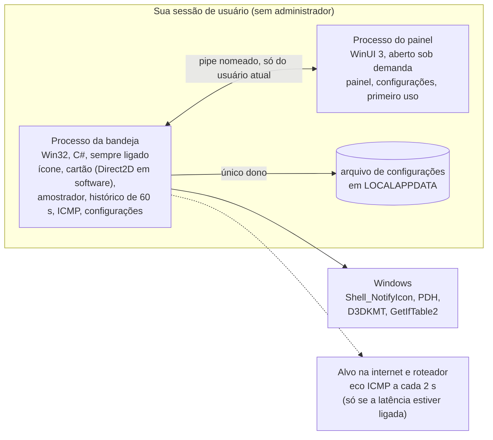

- **Processo da bandeja (Win32, C#):** o ícone de notificação, o cartão, o amostrador e as configurações. O cartão é Win32 puro com Direct2D e DirectWrite, sem XAML, para a memória ficar baixa. Os recursos gráficos dele só existem enquanto o cartão está aberto (mais alguns segundos).
- **Processo do painel (WinUI 3):** painel, janela de configurações e primeiro uso. Abre quando você clica, se esconde quando você fecha e sai depois de alguns minutos parado. Nunca coleta nada: lê do processo da bandeja por um pipe do usuário.
- **Por que não um processo só?** Estima-se que um processo WinUI residente custe de 30 a 60 MB; só o processo da bandeja precisa caber em cerca de 15 MB.
- **Stack:** C# em .NET 10, Win32, Direct2D, WinUI 3 (Windows App SDK). Os builds de release são NativeAOT, gerados no CI.

## 🔒 Privacidade

O Trayce Monitor foi desenhado para **não coletar dados pessoais nem telemetria**. Tudo o que ele lê fica no seu PC, o histórico existe só na memória e nada é gravado em disco além do arquivo de configurações.

Há exatamente duas formas de o Trayce Monitor falar com a rede, ambas visíveis na interface e ambas desligáveis:

1. **Latência (opcional, desligada por padrão).** Quando você a liga, o Trayce Monitor envia um ping ICMP pequeno a cada 2 segundos para o endereço que você escolher (padrão `1.1.1.1`, operado pela Cloudflare) e para o seu roteador. Quem recebe o ping vê o seu endereço IP público. O endereço do roteador é detectado sozinho e não se edita, então o Trayce Monitor não é um scanner de rede local.
2. **Checagem de atualização (planejada).** Uma vez por dia, depois do primeiro uso, o Trayce Monitor pergunta à API de Releases do GitHub se há versão nova. O GitHub vê o seu IP e a versão do aplicativo. Dá para desligar e nada é baixado sem um clique.

O Trayce Monitor nunca manda você desligar o firewall ou o antivírus, nem quando o ping é bloqueado.

## 🗺️ Roteiro

| Etapa | O quê | Estado |
|---|---|---|
| Design | Design de interface v2.2 (ícone, cartão, painel, configurações, primeiro uso, latência) | Pronto, aprovado |
| Prova de conceito | Ícone de bandeja, cartão, sensores e ICMP medidos numa máquina | Pronta, descartável |
| Arquitetura | Desenho de dois processos, orçamento de coleta, empacotamento | Proposta |
| **v1** | Tudo em [Recursos](#-recursos-planejados-para-a-v1), instalador por usuário e versão portátil, GitHub Releases, CI | Build inicial (pré-releases no GitHub) |
| Depois da v1 | Temperatura da CPU por um driver **opcional**, com um passo explícito de administrador no instalador | Ideia, design guardado |
| Depois da v1 | Pacote no winget | Ideia |
| Depois da v1 | Releases assinadas | Decisão em aberto |
| Mais adiante | Barra de tarefas nas outras bordas (hoje experimental no Windows Insider), mais builds do Windows e escalas de DPI verificadas | Ideia |

## 🛠️ Compilar a partir do código

Você precisa do Windows 11 e do [SDK do .NET 10](https://dotnet.microsoft.com/download/dotnet/10.0). Mais nada.

```powershell
git clone https://github.com/dvd-castro/trayce-monitor.git
cd trayce-monitor
dotnet build TrayceMonitor.slnx -warnaserror      # app + testes de unidade
dotnet test TrayceMonitor.slnx                    # testes de unidade do núcleo
dotnet publish src/TrayceMonitor -c Release -o out/publish   # autocontido, ReadyToRun + trimming
.\out\publish\TrayceMonitor.exe
```

Para gerar os mesmos arquivos de uma release (zip portátil, SHA-256 e, se o [Inno Setup 6](https://jrsoftware.org/isinfo.php) estiver instalado, o instalador), rode `.\tools\build-release.ps1 -Version 0.1.0`. Ele usa NativeAOT quando o linker do MSVC está presente e ReadyToRun no caso contrário; os arquivos vão para `out\release`. As releases são geradas pelo GitHub Actions quando uma tag `v*` é enviada.

- `TrayceMonitor.exe --selftest` abre o cartão e o painel sem mexer no mouse, grava o resultado em `%LOCALAPPDATA%\TrayceMonitor\trayce.log` e sai (código 0 = passou).
- `TrayceMonitor.exe --quit` fecha a instância em execução.
- NativeAOT está disponível com `-p:TrayceAot=true`, mas pede o linker do MSVC (Visual Studio Build Tools com a carga de trabalho de C++).
- A configuração fica em `%LOCALAPPDATA%\TrayceMonitor\settings.json`.

## ❓ Perguntas frequentes

<details>
<summary><b>Dá para baixar?</b></summary>

Sim. Veja [Download](#-download): um instalador (por usuário) e um zip portátil estão na [página de Releases](https://github.com/dvd-castro/trayce-monitor/releases/latest). Eles ainda não são assinados, então o Windows SmartScreen vai avisar; a seção explica onde clicar e como conferir o SHA-256.
</details>

<details>
<summary><b>Por que não há temperatura da CPU na v1?</b></summary>

O Windows não a expõe para programas comuns. Lê-la exige um driver de sensores em modo kernel e direitos de administrador, e a v1 do Trayce Monitor não promete nenhum dos dois. A temperatura da GPU não precisa de driver, então ela entra. A temperatura da CPU fica no roteiro como um passo opcional e bem explicado.
</details>

<details>
<summary><b>Precisa de administrador?</b></summary>

Não. O instalador é por usuário, o aplicativo roda sem elevação e o ping de latência usa a API ICMP do Windows, que funciona sem elevação (confirmado na PoC).
</details>

<details>
<summary><b>Por que um anel e não um número?</b></summary>

Em 16 pixels um número vira texto de pixel ilegível. Um anel com um arco que gira lê num relance; o valor exato está no cartão.
</details>

<details>
<summary><b>Por que a latência vem desligada?</b></summary>

É o único recurso que envia pacotes para fora do seu PC, e quem os recebe vê o seu endereço IP. Está a uma chave de distância, e o aplicativo diz o que envia e para quem.
</details>

<details>
<summary><b>Quais versões do Windows são suportadas?</b></summary>

O alvo é o Windows 11. O design e a PoC foram conferidos numa única build do Windows 11 (26H2, 26300.9711) a 96 dpi; outras builds e escalas não foram testadas.
</details>

<details>
<summary><b>Por que as prévias estão em português?</b></summary>

O design foi escrito primeiro em português do Brasil. A localização para outros idiomas ainda não foi planejada.
</details>

## 🤝 Contribuir

O repositório fica em [github.com/dvd-castro/trayce-monitor](https://github.com/dvd-castro/trayce-monitor). O aplicativo está em build inicial e ainda não há fluxo de pull request aberto; as diretrizes de contribuição serão adicionadas antes da primeira release. As regras de base serão as prioridades do projeto: **leveza primeiro** (um recurso que custa memória ou CPU no processo sempre ligado precisa de medição), **sem direitos de administrador**, **acessível por padrão** e **status honesto** na documentação. Os commits seguem [Conventional Commits](https://www.conventionalcommits.org/pt-br/).

## 📄 Licença

[MIT](LICENSE) © 2026 David Castro

*O Trayce Monitor não tem relação com outros softwares chamados Trayce.*
